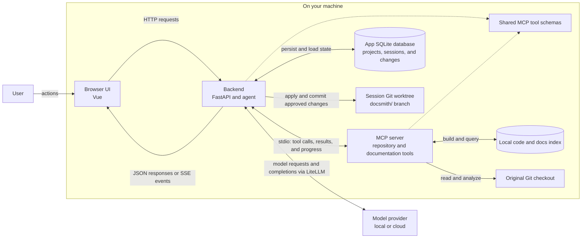

# Docter (Beta)

Docter is a locally run AI agent for reviewing and improving documentation in
Git repositories. Its code index and coverage analysis focus on Python.

- **Add:** draft docstrings and API reference pages.
- **Fix:** find and fix stale docstrings, broken links, and failing examples.
- **Find Missing:** report documentation coverage and flag missing docs for public APIs.
- **Translate:** translate documentation while preserving code blocks and Markdown structure.

## Quick start

On Linux or WSL, install Git, Python 3.12, [uv](https://docs.astral.sh/uv/), Node.js
20.19+ (20.x), 22.13+ (22.x), or 24+, and pnpm 10. From the repository root, run:

```bash
bash scripts/dev.sh
```

Open [http://localhost:5173](http://localhost:5173). The launcher installs frontend
dependencies and starts the Vite frontend and FastAPI backend. The backend
starts MCP on demand and initializes its local SQLite database. Press Ctrl+C to
stop both services. If your configured LLM provider is a separate local service
such as Ollama, it still needs to be running.

1. In **Settings**, choose a provider, enter an API key if required, and select
   **Save**, then **Test connection**. Docter supports OpenAI, Anthropic, Ollama,
   and other [LiteLLM](https://github.com/BerriAI/litellm) providers via **Other**.
2. In **Projects**, register a local Git repository using its absolute path on
   the machine running the backend. Open the project and choose **Index**.
3. Once indexing finishes, choose a mode and select **Start session**. Translate
   requires a target language tag such as `de` or `pt-BR`. Send a message to tell
   the agent what to work on.
4. In **Changes**, select a proposed file to review its diff. Approve or deny the
   whole change or individual hunks, or leave a comment to request a revision.
   Docter commits approved changes on a dedicated `docsmith/` branch in a
   separate worktree, leaving your original worktree untouched.

Docter stores API keys in the OS keyring, not its database. If saving a key
fails on WSL or a headless setup, check the
[keyring requirements](backend/README.md#keyring-availability). Leave the key field
blank to keep the saved key, or select **Remove key** and **Save** to delete it.
The app runs locally, but a cloud model provider receives the context sent to it,
which can include repository content. Ollama can run locally without a saved key.

## Using Docter

- **Projects:** **Index** and **Re-index** show live progress, the last successful
  indexing time, and any failure details. A dirty worktree does not block
  registration. Removing a project from Docter does not delete repository files.
- **Chat:** Press Enter to send or Shift+Enter for a new line. Select **Stop** to
  cancel an active run. Expand tool cards to inspect their arguments and results;
  warnings and errors appear inline.
- **Review:** Switch between side-by-side and inline diffs, or select a hunk
  header to jump to it. **Approve all pending** asks for confirmation. A conflict
  means the patch could not be applied. Review comments stream the revision into
  chat; version links let you navigate between proposals.
- **Coverage:** Filter gaps by missing type or sort by file. Select symbols and
  choose **Send to Add mode** to create an Add session for the same project with an
  editable draft. The draft is not sent automatically.
- **History:** Filter sessions by project, check pending, applied, and denied
  change counts, copy the branch name, or resume a session. Deleting a session
  removes its history and worktree but keeps its Git branch, if one exists.

## System architecture

Docter runs the browser UI, API, and MCP server on your machine. The backend
coordinates the workflow: the UI never calls Git, MCP, or the model provider
directly. Depending on your settings, the model provider can be local or remote.



### Request and response flow

1. **Index a project.** The UI sends a request to start indexing. The backend
   returns `202 Accepted` and runs the job in the background. MCP reads the
   checkout and builds the local index; the UI polls the backend for progress
   and the final status.
2. **Send a message.** The UI posts to the session's chat endpoint. The backend
   asks the model for a response and calls MCP tools as needed. It sends text,
   tool results, and proposal notifications back as server-sent events (SSE).
   The UI fetches the saved patches separately to show their diffs.
3. **Review a proposal.** The UI submits a decision over HTTP. Approval applies
   and commits the approved changes on the session branch, leaving the original
   checkout untouched. Denial records the decision without applying the patch.
   A review comment starts a revision run that streams back into the same chat.

See the [frontend](frontend/README.md#architecture),
[backend](backend/README.md#architecture), and
[MCP server](mcp_server/README.md#architecture) diagrams for component internals.

## Backend development

Install Python 3.12 and [uv](https://docs.astral.sh/uv/), then run from the repository root:

```bash
uv sync
uv run docter                              # http://127.0.0.1:8000
uv run pytest backend/tests                # backend tests (offline LLM/MCP fakes)
uv run ruff check backend
uv run mypy backend
```

The API docs are at http://127.0.0.1:8000/docs. Run a single backend worker: chat and
indexing jobs are process-local. Startup resets interrupted chat runs to `idle` and
interrupted indexing jobs to `failed`, allowing them to be retried.

Export the OpenAPI contract for the frontend after API changes:

```bash
uv run python -m backend.scripts.export_openapi
uv run python -m backend.scripts.export_openapi --check
```

The script writes `frontend/src/api/openapi.json` without starting the backend, MCP,
or database. The offline approval-flow test is
`uv run pytest backend/tests/test_e2e.py`; it indexes through a stub MCP server,
chats with a fake LLM, approves its proposed patch, and checks the real commit on
the session's `docsmith/` branch.

## Frontend development

Use Node.js 20.19+ (20.x), 22.13+ (22.x), or 24+, and pnpm 10. Run from the
repository root:

```bash
cd frontend
pnpm install --frozen-lockfile
pnpm gen:api
pnpm lint
pnpm typecheck
pnpm test
pnpm build   # writes frontend/dist
pnpm dev     # http://localhost:5173
```

`pnpm gen:api` regenerates `frontend/src/api/schema.d.ts` from
`http://127.0.0.1:8000/openapi.json`, or from the checked-in
`frontend/src/api/openapi.json` when the endpoint is unavailable.

To run the Chromium smoke test used in frontend CI, run from `frontend/` on Linux:

```bash
pnpm exec playwright install --with-deps chromium
pnpm build
pnpm e2e
```

Playwright starts `pnpm preview` on `127.0.0.1:4173` and exercises the Fix workflow
from saving settings through approving a change. It mocks the API and chat event
stream, so it needs no running backend, API key, or test Git repository.

Shared UI primitives live in `frontend/src/components/common/`. Bind `AppInput`
and `AppSelect` with `v-model` and provide a visible `label`. Control `AppModal`
with `:open` and set it to `false` in the `@close` handler. Set the Tailwind
`dark` class on `<html>` so it also applies to the dialog teleported to `<body>`.

Use `useToast()` for success, error, info, and warning notifications. Up to four toasts
stack at once; they dismiss after five seconds, or sooner if dismissed manually
or replaced by a newer toast. Uncaught Vue errors and unhandled promise rejections
show the API message for an `ApiError` and a generic message otherwise.

For POST-based event streams, `useEventStream(url, body)` exposes `start()`,
`abort()`, `isStreaming`, and `onEvent(handler)`. The handler receives typed
events, and `onEvent` returns an unsubscribe function. A stream never
retries automatically, including when the tab is hidden, and is aborted when
its component unmounts.

To run the services separately, start `uv run docter` from the repository root.
Vite forwards `/api` to `http://127.0.0.1:8000` by default, or to the port set by
`DOCTER_PORT`. Run `pnpm preview` from `frontend/` to serve the production build
locally.

If you serve `frontend/dist` outside Vite, configure your server to serve `index.html`
for client-side routes, without rewriting `/api` requests.

## Documentation

- [Backend](backend/README.md): configuration, API reference, and development guide.
- [Frontend](frontend/README.md): architecture, client state, and REST and streaming workflows.
- [MCP server](mcp_server/README.md): architecture, stdio setup, repository access rules, tools, and resources.
- [Tool contract](contract/README.md): the shared MCP tool schemas and how to regenerate `contract/schema.json`.
