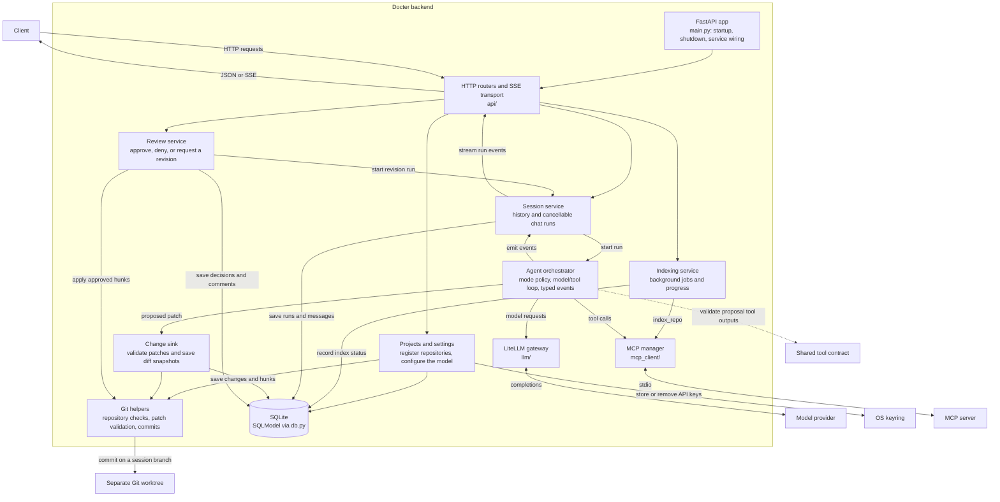

# Docter Backend

FastAPI backend for Docter. It hosts the agent, acts as the MCP client, stores state in SQLite, and serves the built Vue UI.

See [`../docs/README.md`](../docs/README.md) for the overall project plan and [`../docs/backend_features.md`](../docs/backend_features.md) for the backend roadmap.

## Requirements

- Python 3.12
- [uv](https://docs.astral.sh/uv/)

## Quick start

Run these commands from the repository root:

```bash
uv sync          # create .venv and install dependencies
uv run docter  # start the server on http://127.0.0.1:8000
```

To check that the server is running:

```bash
curl http://127.0.0.1:8000/api/health
# {"status":"ok","version":"0.1.0"}
```

Interactive API docs are available at http://127.0.0.1:8000/docs.

Endpoints are grouped under `health`, `settings`, `projects`, `sessions`, and
`changes` OpenAPI tags. Regenerate the frontend contract after API changes:

```bash
uv run python -m backend.scripts.export_openapi
uv run python -m backend.scripts.export_openapi --check
```

The exporter creates `frontend/src/api/openapi.json` (including its parent
directories). `--output <path>` selects a different destination; `--check` exits
with status 1 for a missing or stale file without modifying it. Exporting does
not start the application lifespan, create its data directories, or launch MCP.

## Configuration

Settings are read from environment variables with the `DOCTER_` prefix (see `config.py`).

Fixed defaults, timeouts, logging constants, and shared validation helpers also live on
the `Settings` class in `config.py` as `ClassVar` attributes. These are not environment
fields. Define configuration on this class, not as module-level variables in consumers.

| Variable                     | Default                        | Description                                         |
|------------------------------|--------------------------------|-----------------------------------------------------|
| `DOCTER_DATA_DIR`          | `~/.docter`                  | Root directory for all local data                   |
| `DOCTER_HOST`              | `127.0.0.1`                    | Bind address                                        |
| `DOCTER_PORT`              | `8000`                         | Bind port                                           |
| `DOCTER_LOG_LEVEL`         | `INFO`                         | `DEBUG`, `INFO`, `WARNING`, `ERROR`, or `CRITICAL`  |
| `DOCTER_CORS_ORIGINS`      | `["http://localhost:5173"]`    | Allowed CORS origins, given as a JSON list          |
| `DOCTER_FRONTEND_DIST_DIR` | `<repo>/frontend/dist`         | Directory containing the built Vue app              |
| `DOCTER_MCP_COMMAND`       | `uv run docter-mcp`            | Command that starts the Docter MCP server (shell-style quoting) |

### Data directory layout

These paths are derived from `data_dir`. They are created at startup.

```
~/.docter/
  docter.db     # SQLite database
  index/          # vector indexes
  worktrees/      # git worktrees for sessions
  logs/           # docter.log (rotating, 5 MB x 3) and mcp-server.log (MCP server stderr)
```

### SQL schema migrations

From the repository root, run `uv sync` to install the Alembic tooling. Migrations
use the same local `docter.db` as the backend (`~/.docter/docter.db` by default, or
`$DOCTER_DATA_DIR/docter.db` if set) and the existing `aiosqlite` driver. No data is
sent to a remote service.

**Fresh database:** Run `uv run alembic upgrade head` before starting Docter.
Alembic creates the schema and records its revision in `alembic_version`. Use
`uv run alembic current` to see the recorded revision. Ordinary `uv run docter`
startup still creates missing tables with SQLModel `create_all`; it does not run
migrations or record a revision.

**Existing, unversioned SQLite database:** Stop Docter and other writers, verify
the data directory and database path, and take a backup before running Alembic.
For example, with the SQLite CLI and a new backup filename (replace the source
path if you set `DOCTER_DATA_DIR`):

```bash
sqlite3 -readonly "$HOME/.docter/docter.db" '.backup docter-before-alembic.db'
```

1. Confirm there is no `alembic_version` table and that the existing schema
   matches revision `0001`. To get a reference schema, use a new, empty data
   directory: `DOCTER_DATA_DIR=/path/to/empty-scratch-dir uv run alembic upgrade 0001`.
   Use `sqlite3 -readonly /path/to/docter.db '.schema'` on the backup and the
   reference database; compare the application tables, columns, constraints, and
   indexes, ignoring `alembic_version` and formatting or statement ordering.
   If the schema differs, do not stamp it; resolve the differences on a copy first.
2. With `DOCTER_DATA_DIR` pointing back to the **existing** database's directory
   (or unset for the default path), run `uv run alembic stamp 0001`. Stamping
   records only the revision; it does not recreate tables or alter app rows.
3. Run `uv run alembic upgrade head` to apply any later revisions, then
   `uv run alembic current` to verify the result before restarting Docter.

Do not run `upgrade head` directly on an unversioned database that already has
app tables. Downgrading to `base` drops the app tables and their data; it is not
a backup or a way to undo a stamp.

## Architecture



The key distinction is that **chat proposes changes; review applies them**.
Chat and revision runs stream events back over SSE and save proposals for
inspection. Approval applies the selected hunks in a separate session worktree;
denial records a decision without applying a patch. Indexing runs separately:
the client polls the backend for progress rather than opening an SSE stream.

| Module              | Responsibility                                                                 |
|---------------------|--------------------------------------------------------------------------------|
| `main.py`           | `create_app()` factory, lifespan, CORS, routers, and static UI mount           |
| `cli.py`            | `docter` console script that runs uvicorn                                    |
| `config.py`         | `Settings` (pydantic-settings) and derived paths                               |
| `db.py`             | Async SQLModel engine, `create_all`, and the `get_session` dependency          |
| `errors.py`         | `DocterError` base class and the global exception handlers                   |
| `logging_config.py` | Stdlib logging to the console and `logs_dir`                                   |
| `static.py`         | `SPAStaticFiles`: serves `frontend/dist` and falls back to `index.html`        |
| `api/`              | HTTP routers (`health.py`, `settings.py`, `projects.py`, `sessions.py`, `changes.py`), shared SSE transport, and dependencies (`deps.py`) |
| `models/`           | SQLModel tables, the separate Pydantic request/response schemas, and `UTCDateTime` |
| `services/`         | Settings, projects, indexing jobs, session/chat workers, persisted changes/reviews, and the keyring-backed `ApiKeyStore` |
| `git/`              | Repository inspection, patch validation/isolated previews, and session worktree approvals |
| `mcp_client/`       | `MCPManager` (`manager.py`): runs the Docter MCP server over stdio and calls its tools |
| `llm/`             | LiteLLM gateway, typed completion events, MCP tool conversion, and sampling callback |
| `agent/`           | [Mode policies, cancellable orchestration, typed events, and proposal sinks](agent/README.md) |

### Lifespan

At startup the app creates the data directories, configures logging, creates the async engine, runs `create_all`, and stores `engine`, `sessionmaker`, an `MCPManager` (`mcp`), an `IndexingService` (`indexing`), a `SessionService` (`sessions`), a `GitService` (`git`), and a `ReviewService` (`review`) on `app.state`. Before accepting requests, it resets stale session `run_status=running` flags to `idle` and project `index_status=running` flags to `failed`. Other statuses, history, branch names, and the last successful indexing timestamps are preserved; recovery is idempotent. At shutdown it cancels and awaits chat and indexing jobs, stops the MCP server, if running, and disposes of the engine.

### Database sessions

Use the dependency in routes or services:

```python
from typing import Annotated
from fastapi import Depends
from sqlmodel.ext.asyncio.session import AsyncSession
from backend.db import get_session

SessionDep = Annotated[AsyncSession, Depends(get_session)]
```

### Errors

Every error response has the same JSON shape:

```json
{"error": {"code": "not_found", "message": "Not Found"}}
```

- **Domain errors:** subclass `DocterError` and set `status_code` and `code`.
- **HTTP and validation errors:** mapped to the same shape. Validation errors use the `validation_error` code.
- **Unhandled exceptions:** logged with a traceback. The client receives a 500 response with `internal_error` and no internal details.

Error codes are stable lower-case identifiers; clients should branch on `code`,
not the human-readable `message`. OpenAPI uses the shared `ErrorResponse` schema
for common error statuses, including validation failures rather than FastAPI's
default `detail` envelope.

Every HTTP response, including errors, CORS preflights, and SSE streams, has an
`X-Request-ID` header. A supplied ID is echoed if it contains 1-128 ASCII letters,
digits, `.`, `_`, or `-`; missing or invalid IDs are replaced with a generated UUID4
hex string. Handlers can read `request.state.request_id`; unhandled-error logs
include it. CORS exposes the response header to the frontend. Request IDs do not
alter the error JSON or the SSE run/event IDs.

### Frontend serving

If `frontend_dist_dir` exists, it is mounted at `/`:

- Unknown non-API paths fall back to `index.html` so Vue Router can handle them.
- `/api/*` paths never fall back. Unknown API routes return a JSON 404.

During development, run the Vite dev server on `http://localhost:5173` instead. CORS allows that origin.

## LLM settings

The LLM configuration is stored as a single row in the `app_settings` table. It has these fields: `provider`, `model`, `base_url` (optional), `embedding_model`, `temperature` (0–2), and `max_agent_steps` (1–200, default 25).

The **API key is stored only in the OS keyring**, under service `docter` with the provider as the username. It is never written to the database, returned by the API, or logged.

| Endpoint                   | Description                                                                              |
|----------------------------|------------------------------------------------------------------------------------------|
| `GET /api/settings`        | Returns the settings plus `has_api_key`. Defaults apply if nothing has been saved yet.  |
| `PUT /api/settings`        | Partial update. Omitted fields are unchanged; `base_url: ""` or `null` clears it.        |
| `POST /api/settings/test`  | Sends a 1-token LiteLLM completion with a 15 s timeout and returns `{ok, latency_ms, error}`. |

`api_key` handling in `PUT /api/settings`:

- **Omitted or `null`:** the stored key is unchanged.
- **`""`:** the key for the provider is deleted.
- **Any other value:** the key is stored for the provider (the new provider, if `provider` changes in the same request).

Example:

```bash
curl -X PUT http://127.0.0.1:8000/api/settings \
  -H 'Content-Type: application/json' \
  -d '{"provider": "ollama", "model": "llama3.1", "base_url": "http://localhost:11434"}'
curl -X POST http://127.0.0.1:8000/api/settings/test
# {"ok": true, "latency_ms": 412, "error": null}
```

The connection test uses the **saved** settings. A failure still returns HTTP 200 with `ok: false`. The error message is truncated, and the API key is masked if the provider echoes it.

### Keyring availability

Docter uses the `keyring` package, which supports macOS Keychain, Windows Credential Locker, GNOME Keyring/Secret Service, and KWallet. If no backend is available (for example in WSL or on a headless server):

- `has_api_key` is reported as `false`.
- Saving or deleting a key returns `503` with `{"error": {"code": "keyring_unavailable", ...}}`. Other fields in the same request are not saved.

Local providers such as Ollama don't need a key.

## Projects

A project is a local git repository registered with Docter. The `projects` table stores `id`, `name` (the directory name), `path` (absolute, resolved, unique), `current_branch`, `index_status` (`idle` | `running` | `done` | `failed`), `indexed_at`, and `created_at`. Timestamps are UTC.

| Endpoint                      | Description                                                                   |
|-------------------------------|-------------------------------------------------------------------------------|
| `POST /api/projects {path}`   | Validates and registers a repository. Returns `201` with `is_dirty` and `warnings`. |
| `GET /api/projects`           | Lists all projects, oldest first.                                             |
| `GET /api/projects/{id}`      | Returns one project.                                                          |
| `DELETE /api/projects/{id}`   | Removes the database record only (`204`). Files on disk are never touched.    |
| `POST /api/projects/{id}/index` | Starts a background MCP `index_repo {path}` job (`202`); returns `409` (`index_running`) if one is already running for this project. |
| `GET /api/projects/{id}/index/status` | Returns `{status, progress, message, indexed_at, error}`. Unknown projects return `404`. |

Validation for `POST /api/projects`. Every error uses the standard error shape:

| Case                                          | Status | `code`                |
|-----------------------------------------------|--------|-----------------------|
| Relative path (`~` is expanded)               | 400    | `invalid_path`        |
| Path does not exist                           | 400    | `path_not_found`      |
| Path is not a directory                       | 400    | `not_a_directory`     |
| Not a git repository, or a bare repository    | 400    | `not_a_git_repo`      |
| Subdirectory of a repository (not its root)   | 400    | `not_repository_root` |
| Git failed to read the repository             | 400    | `git_error`           |
| Same resolved path already registered         | 409    | `project_exists`      |

The path is resolved before it is stored, so symlinks and `.` segments map to the same project. `current_branch` is `null` for a detached HEAD.

A dirty working tree, including untracked files, does not block registration. The response has `is_dirty: true` and a message in `warnings`.

### Indexing jobs

The app-wide `IndexingService` owns one asyncio task per active project. Jobs use their
own database sessions, not request sessions. MCP progress notifications with a positive
total are converted to percentages and clamped to 0-100; notifications without a total
update the message but leave the percentage unchanged. Success sets `index_status`
to `done`, progress to 100, and `indexed_at` to the current UTC time. Tool errors,
transport failures, and timeouts set the status to `failed` and expose an error message.
The indexing request timeout is `Settings.INDEX_TIMEOUT_S` (one hour).

Progress, messages, and errors are in memory and reset on application restart; project
status and the last successful `indexed_at` are persisted. A failed re-index preserves
the previous successful timestamp. Completed or failed jobs can be started again.
Graceful shutdown cancels active jobs and marks them failed before closing the database.
Startup marks any indexing jobs left `running` by an interrupted process as `failed`;
these can be retried through the normal indexing endpoint.
The registry is process-local: run a single backend worker.

## Sessions and chat

`Session` (`models/session.py`, table `sessions`) stores `id`, `project_id` (an
indexed foreign key to `projects.id`), `mode`, `mode_params` (a JSON object,
default `{}`), nullable `branch_name`, `run_status` (`idle` by default, or
`running`), `created_at`, and `updated_at`. Both timestamps use UTC;
`updated_at` advances automatically when the session row is updated.

`Message` (`models/message.py`, table `messages`) stores `id`, `session_id` (an
indexed foreign key to `sessions.id`), `role`, nullable text `content`, nullable
`tool_calls` (a JSON array), nullable `tool_call_id`, and UTC `created_at`.
Assistant tool-call messages can omit content; tool replies use `tool_call_id`
to correlate with a call in the assistant's `tool_calls`.

Both tables are registered for startup schema creation. API schemas are defined
separately in `models/chat.py`. Creating a session does not create a git branch or
modify the project.

| Endpoint | Description |
|----------|-------------|
| `POST /api/sessions {project_id, mode, mode_params}` | Creates a session (`201`). Returns `409`, code `project_not_indexed`, unless the project's `index_status` is `done`. |
| `GET /api/sessions?project_id={id}` | Lists the project's sessions oldest first (id breaks timestamp ties), each with `change_counts: {pending, applied, denied}`. Counts proposals across all runs by their exact status, not hunks; other statuses are excluded. Empty projects return `[]`; `project_id` is required and must be positive. |
| `GET /api/sessions/{id}` | Returns session fields plus `messages`, oldest first, with message id as the timestamp tie-breaker. |
| `DELETE /api/sessions/{id}` | Cancels and awaits active chat, removes the clean worktree, and deletes the session, messages, change sets, proposals, hunks, and comments (`204`). Keeps the Git branch and its commits. Serialized with review decisions; a Git removal failure preserves saved history and returns `git_error` without forcing removal of user edits. |
| `GET /api/sessions/{id}/changes` | Returns change sets, oldest first, with nested changes, hunks, and per-change original/proposed contents. |
| `POST /api/sessions/{id}/chat {message}` | Persists the user message and returns an SSE stream. Returns `409`, code `session_running`, if the session already has an active run. |
| `POST /api/sessions/{id}/cancel` | Cancels and awaits the active run (`204`). Already-idle sessions are unchanged. |

Unknown sessions return `404` (`session_not_found`); unknown projects return
`404` (`project_not_found`). Invalid bodies return `422` (`validation_error`).
Modes use the [agent's policies](agent/README.md#modes), including validation of
translation's `target_language` (`422`, `invalid_mode_params`). `mode_params`
defaults to `{}`. Chat messages must contain non-whitespace text; their original
whitespace is preserved.

### SSE and persistence

Chat uses `sse-starlette`. Each orchestrator event has an SSE `event` matching its
`type`, JSON `data` containing the complete event, and a unique `id` consisting
of a run id and a monotonically increasing sequence number:

```text
id: <run-id>:1
event: token
data: {"type":"token","text":"Hello"}

id: <run-id>:2
event: done
data: {"type":"done","reason":"completed","steps":1}

```

The stream forwards all agent event types, including tool calls/results,
proposals, warnings, errors, and completion. Before streaming starts, errors use
the normal JSON HTTP error shape. Once streaming starts, failures emit `error`
and `done` events; unexpected failures expose only `internal_error`, not internal
exception details.

`SessionService` owns one worker per active session and uses its own database
sessions, not request-scoped sessions. It loads saved LLM settings and the
keyring-backed provider key for each run. A bounded event buffer applies
backpressure to slow clients. Different sessions can run concurrently. Like
indexing, the worker registry is process-local: run a single backend worker.

The user message is committed when the run is accepted. An optional orchestrator
completion callback commits each whole assistant message before tool execution,
each tool reply before its `tool_result` event, and the final assistant message
before `done`. Partial assistant output is not saved. Subsequent runs replay
persisted history without duplicating the new user message. If cancellation
interrupted a tool batch, replay includes only calls with completed replies;
the original persisted messages remain unchanged.

Client disconnects, explicit cancellation, and application shutdown cancel and
await the worker, close its LLM stream, and restore `run_status` to `idle`.
Cancellation closes the SSE stream without synthesizing a successful `done`.
Startup clears run flags left by a previous process. Event ids identify events
but do not provide replay or reconnection; disconnecting cancels that run.
Patch proposals remain in tool-message history and are also persisted by
`DbChangeSink` after validation. No patches are applied to the project.

### Change sets

Every accepted chat run creates one `change_sets` row with `id`, `session_id`,
unique `run_id` (the same id used by SSE), and UTC `created_at`, even if the run
fails, is cancelled, or proposes nothing. A session can have many change sets.

`changes` stores `id`, `change_set_id`, repo-relative `file_path`, unified-diff
`patch`, `rationale`, `status`, nullable `parent_change_id`, UTC `created_at`,
and immutable UTF-8 `original_content`/`proposed_content` snapshots.
`change_hunks` stores `id`, `change_id`, zero-based `index`, the original hunk
`header`, and `status`. Hunks are parsed with `unidiff` and persisted in order.
Changes and hunks start as `pending`; the status values are `pending`, `approved`,
`denied`, `partial`, `applied`, `conflict`, and `revised`.

`GET /api/sessions/{id}/changes` returns an array of change sets, each containing
`changes`, each containing `hunks` and `comments`. Changes and comments are ordered
by creation time and id; hunks are ordered by index. A session with no runs returns `[]`, and unknown
sessions return `404` (`session_not_found`). The snapshots are captured at
acceptance, so fetching a proposal never depends on the current working tree.
New files have empty original content; deleted files have empty proposed content.

The database sink rejects absolute paths, traversal, Git metadata (including
case variants of `.git`), and symlink paths. A patch must describe exactly its
declared file, have a matching `is_new_file` flag, and pass `git apply --check`
against the working tree. Binary patches, renames, and nonregular-file or
mode-only changes are rejected. Git renders the preview in a disposable directory,
never in the project; line endings and missing final newlines are preserved.
Rejections return an actionable sink `Error`, becoming a tool error so the agent
can retry. A rejected proposal stores neither a change nor any hunks.

### Review API and revisions

| Endpoint | Description |
|----------|-------------|
| `POST /api/changes/{id}/approve {hunks?}` | Applies and commits selected zero-based hunks through `GitService.apply_hunks`; returns the updated change with hunks and comments. |
| `POST /api/changes/{id}/deny {hunks?}` | Denies selected hunks without touching Git; returns the updated change. |
| `POST /api/sessions/{id}/changes/approve-all` | Applies remaining reviewable changes in creation order; returns an array of the changes attempted. |
| `POST /api/changes/{id}/comment {text, hunk_index?}` | Stores feedback, marks the proposal `revised`, and streams an agent revision run as SSE. |

For approval and denial, omit the body, use `{}`, or omit/null `hunks` to select
all remaining reviewable hunks. Explicit selections must contain distinct,
in-range integers; an empty selection is invalid except for a hunkless empty-file
creation. Applied and denied hunks are preserved, not re-reviewed. All applied
hunks make the change `applied`; all denied hunks make it `denied`; a mixture or
unfinished review makes it `partial`. Application failures retain the Git service's
`conflict` state. Approve-all skips applied, denied, and revised proposals and
already-decided hunks; it is a sequence of durable per-change commits, not an
all-or-nothing transaction. Responses include conflicts; an unexpected Git error
stops the batch, leaving earlier commits intact.

Unknown changes return `404` (`change_not_found`). Trying to overwrite a final
decision, approve/deny a revised proposal, or review a change with no remaining
hunks returns `409` (`change_not_reviewable`). Invalid hunk selections return
`400` (`invalid_patch`); invalid request types, negative indices, blank comment
text, and unknown fields return `422` (`validation_error`).

`comments` stores `id`, indexed `change_id` (foreign key to `changes.id`),
nullable zero-based `hunk_index`, `text`, and UTC `created_at`. Omitted/null
`hunk_index` addresses the whole proposal. Text whitespace is preserved.
The comment, the parent's `revised` status, the user message, and the new run's
change set are committed together before SSE starts. A busy session returns
`409` (`session_running`) without saving feedback or changing the proposal.

The revision prompt includes the original patch, file path, comment, and optional
hunk index and instructs the agent to call `propose_patch` again. Every accepted
proposal in that run has `parent_change_id` pointing to the commented change.
Revisions can themselves receive comments, forming a chain; ordinary chat runs
do not inherit a revision parent. Failed/cancelled runs retain their feedback
and change set, and another comment on the revised parent can retry the revision.
Applied or denied proposals cannot be revised. Original patches and snapshots
are never overwritten.

Revision runs use the same event types, run-scoped event ids, persistence,
single-active-run guard, cancellation, and disconnect cleanup as chat. A revision
does not apply anything to Git; its new proposals still require approval.
The app-wide `ReviewService` serializes decisions and revision setup per session;
different sessions remain independent. Like chat and Git locks, review locks
require a single backend worker.

### Git approvals

The app-scoped `GitService` (`git/service.py`, injected with `GitServiceDep`)
exposes `apply_hunks(change, hunk_indices)` for persisted changes. It creates
`worktrees_dir/<session_id>` on first approval, branching from the project's
current **HEAD**, not its uncommitted changes. The branch is `docsmith/<session_id>`
(integer session ids are already short); if that name already exists, a UUID
suffix avoids overwriting a retained branch from a deleted session. The selected
name is saved on the session.
Later approvals reuse that worktree and branch.

Only the selected zero-based hunks are applied, with target offsets adjusted
when earlier hunks are omitted. An empty selection is invalid except for an
empty-file creation without hunks. Git first applies the patch with `--index`,
then retries with `--3way` if necessary. Three-way merging requires blob ids
in the proposed patch and the corresponding objects in the repository.
Successful applications are committed as
`docs(<mode>): <file> - <short rationale>`, authored and committed by
`DocSmith <docsmith@local>`. The rationale is collapsed to one line and truncated
to 72 characters. Repository hooks and commit signing are disabled for these
operations without modifying Git configuration.

Selected hunks become `applied`; the change becomes `partial` until all its
hunks are applied, then `applied`. If both applications fail, selected hunks and
the change become `conflict`. Failed applications are restored to the session
branch's HEAD so conflict markers or unmerged index entries cannot contaminate
later approvals. Already-applied hunks cannot be approved again. Unexpected
Git failures raise `git_error`; dirty session worktrees are not overwritten.

`remove_worktree(session)` removes a clean worktree but retains the branch and
saved branch name. A subsequent approval recreates the worktree on that existing
branch. The service never checks out, stages, commits, or restores files in the
user's working tree, and never pushes. The worktree directory must be outside
the project. Per-session `asyncio.Lock` instances serialize approvals and removal;
different sessions remain independent. Git runs through `asyncio.to_thread`.
Cancellation waits for the operation and database persistence before releasing
the lock. These locks are process-local: use a single backend worker.

## MCP client

`MCPManager` (`mcp_client/manager.py`) runs the Docter MCP server as a subprocess, started with `DOCTER_MCP_COMMAND`, and talks to it over stdio with the official `mcp` SDK. Inject it with `MCPManagerDep` from `api/deps.py`.

- **Lifecycle:** one `ClientSession`, opened on first use and kept open by a background task that holds the transport in an `AsyncExitStack`. It is closed at app shutdown. The server's stderr is appended to `logs/mcp-server.log`.
- **`list_tools()`:** returns the server's tools. The result is cached until the session is closed or restarted.
- **`call_tool(name, args, timeout, progress_callback=None)`:** returns a `ToolResult` with `text`, `structured`, and `is_error`. A tool that runs but fails returns `is_error: true` instead of raising. `progress_callback(progress, total, message)` receives the server's progress notifications.
- **`restart()`:** stops the server and starts a new one.
- **Crash recovery:** if the connection is lost, the failing call raises `MCPError`, and the next call starts a new server.
- **Sampling:** the constructor accepts an optional `sampling_callback` for `sampling/createMessage` requests from the server. The application supplies `llm/sampling.py::SamplingHandler`, which reloads saved settings and the provider's keyring key for each request.

Failures are raised as domain errors:

| Case                                                 | Status | `code`        |
|------------------------------------------------------|--------|---------------|
| The server failed to start, the connection was lost, or a request failed | 502 | `mcp_error` |
| The server did not start, or a tool did not finish, within the timeout | 504 | `mcp_timeout` |

## LLM gateway

`SettingsService.gateway()` builds an `LLMGateway` from the saved `AppSettings`
(or defaults) and the provider's keyring key. Direct callers can also construct
`LLMGateway(settings, api_key)`. A gateway snapshots its configuration.

- `stream_chat(messages, tools=())` uses `litellm.acompletion(stream=True)` and yields
  `TextDelta(text)`, complete `ToolCallRequest(id, name, arguments)` events, `Usage`,
  then `Done`. Tool fragments are accumulated by index, and arguments must decode
  to JSON objects. Usage-only trailing chunks are consumed before completion.
- `complete(messages)` returns `Completion(text, model, stop_reason, usage)`.
  Optional `max_tokens`, `temperature`, and `stop` parameters support MCP sampling.
- Token counts and estimated `cost_usd` are `None` when unavailable, with a warning;
  an unknown model price is never reported as a free completion.
- Rate limits and timeouts get two retries, after 1 and 2 seconds. LiteLLM's internal
  retries are disabled. A stream is not retried once text has been emitted, avoiding
  duplicated output. Failed or truncated streams never emit `Done`.
- Provider failures raise `LLMError` (`502`, `llm_error`) without exposing provider
  error messages that could contain credentials.

Sampling supports text messages, the system prompt, token limit, temperature, and
stop sequences. It returns an MCP assistant message with the actual response model
and normalized stop reason. Non-text content and sampling tools are explicitly
rejected with protocol errors. Server model preferences do not override the user's
configured provider/model, and `includeContext` does not add repository or other
server context.

## Development

```bash
uv run pytest                                      # tests
uv run ruff check . && uv run ruff format --check . # lint and format check
uv run mypy                                        # strict type checking
```

Tests are in `backend/tests/` and mirror the source layout. Shared fixtures are defined in `conftest.py`:

- `data_dir`: a temporary directory, exported as `DOCTER_DATA_DIR`.
- `settings`: a `Settings` instance bound to that directory.
- `app`: the application, built with `create_app(settings)`.
- `client`: an `httpx.AsyncClient` with the lifespan running.
- `clean_log_handlers`: removes the log handlers a lifespan installs. Use it when a test runs the lifespan itself.
- `memory_keyring` (autouse): replaces the OS keyring with `tests/fakes.py::InMemoryKeyring`, so tests never touch real credentials.
- `make_git_repo`: a factory for temporary git repositories on branch `main`, optionally with an initial commit or as a bare repository (see `tests/git_utils.py`).
- `stub_mcp_command`: runs `tests/fixtures/stub_mcp_server.py`, an `MCPServer` (formerly FastMCP) with the tools `echo`, `index_repo` (reports progress), and `propose_patch` (returns its input as structured output).

LiteLLM is never called for real in tests. Tests replace `litellm.acompletion` with a fake using `monkeypatch`, and `conftest.py` sets `LITELLM_LOCAL_MODEL_COST_MAP=True` so importing LiteLLM stays offline.

### Conventions

- Use async for all I/O. Keep routers thin, put logic in services, and inject services with `Depends`.
- Keep Pydantic request and response schemas separate from SQLModel tables.
- Use full type hints (mypy strict) and add docstrings to public functions.
- Never store or log secrets. API keys belong in the OS keyring.
- Every change ships with tests. Tests, ruff, and mypy must all pass.
