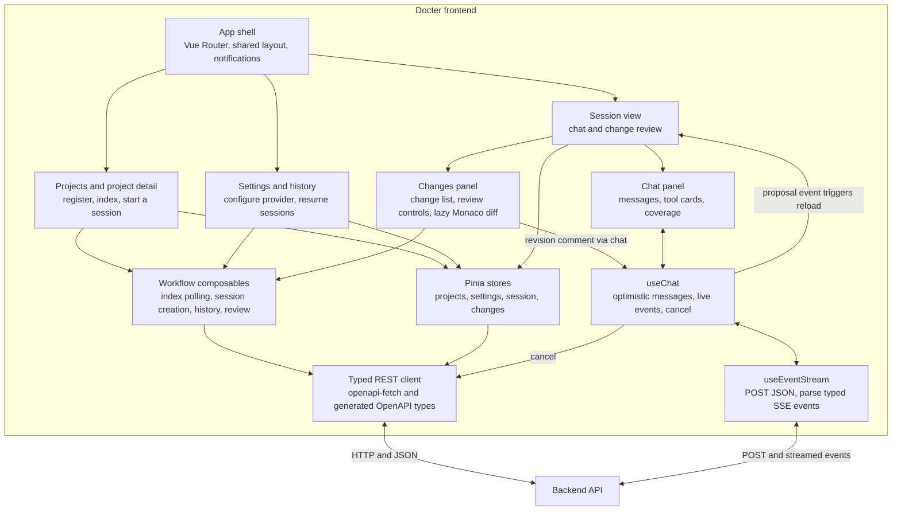

# Docter Frontend

Docter is a Vue 3 single-page app built with Vite and TypeScript. Vue Router
selects the page, Pinia holds shared UI and API state, and composables coordinate
workflows such as indexing, chat, and patch review. The browser calls the
backend; it does not talk directly to MCP, Git, or the model provider.

## Architecture

## How data moves

- **Index and start a session.** The project page starts indexing over REST.
  `useIndexStatus` polls once a second while indexing is running and stops on
  completion, failure, or unmount. Session creation is enabled only after
  indexing succeeds; it opens the new session at `/sessions/:id`.
- **Load and stream chat.** The session store loads saved messages and project
  metadata. `useChat` adds a user message immediately, then uses `useEventStream`
  to append tokens, pair tool calls with results, and display notices. Assistant
  Markdown is rendered with markdown-it and sanitized with DOMPurify. The same
  streaming path handles revision comments; streams do not retry automatically
  and are aborted on unmount.
- **Review a patch.** A `change_proposed` event refreshes the changes store.
  Selecting a file opens its original and proposed snapshots in a read-only
  Monaco diff. The browser remembers the side-by-side or inline layout.
  Approve and deny actions use REST and refresh both the changes and session
  metadata, so an updated branch name appears without remounting chat.

See [Frontend development](../README.md#frontend-development) for setup,
API type generation, and test commands.
