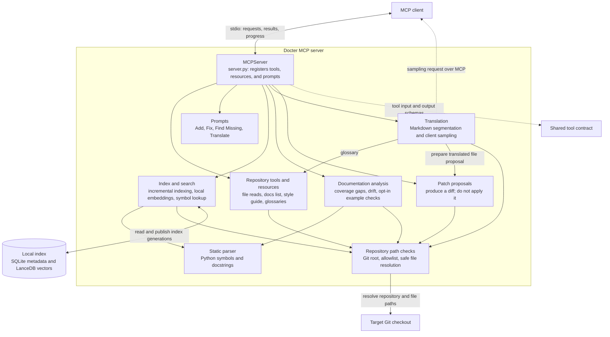

# Docter MCP server

The server runs over stdio using the official MCP 2 SDK's `MCPServer`
(the renamed FastMCP API). All tool input
and output schemas are the shared `docter_contract` models, including flat tool arguments.
The server never writes to the target repository itself. Repository code is executed
only by explicitly enabled documentation example checks; see the execution warning below.

## Architecture



Tool calls name their repository explicitly; resources and prompts use the
repository selected at server startup. Search and symbol lookup use a local
index, while coverage checks analyze the current files without requiring an
index. Translation asks the MCP client to generate text through sampling, then
returns a proposed diff. Applying that diff is the caller's responsibility.

## Install

Install [uv](https://docs.astral.sh/uv/getting-started/installation/) and Git, then run
from the workspace root. The server requires Python 3.12 or newer.

```sh
uv sync --locked --package docter-mcp --no-default-groups
uv run --no-sync docter-mcp --repo /absolute/path/to/repo
```

Neither command needs the Docter backend to be running.

Only MCP messages are written to stdout; logging goes to stderr. `--repo` binds resource
reads and standalone prompts to that repository for the lifetime of the server; it defaults
to the startup working directory. Tool calls specify their own absolute `repo` and do not
change that binding.
Repositories must be Git working-tree roots, not arbitrary subdirectories.

## Claude Desktop and Cursor

In Claude Desktop, open **Settings > Developer > Edit Config** and add the entry below to
`claude_desktop_config.json`, then restart the app. In Cursor, use the same `mcpServers`
entry in `.cursor/mcp.json`. Use absolute paths to the installed `uv` executable, the
Docter workspace, and your target Git repository. On Windows, escape backslashes in JSON.

```json
{
  "mcpServers": {
    "docter": {
      "command": "/absolute/path/to/uv",
      "args": [
        "--directory", "/absolute/path/to/docter-llm",
        "run", "--no-sync",
        "docter-mcp", "--repo", "/absolute/path/to/target-repo"
      ],
      "env": {
        "DOCTER_ALLOWED_ROOTS": "/absolute/path/to/target-repo",
        "DOCSMITH_ALLOW_EXEC": "false"
      }
    }
  }
}
```

In clients that surface MCP prompts, choose `add_docs` for additions, `fix_docs` for
corrections, or `find_missing_docs` for a gaps report without patches. These accept an
optional `scope`. `translate_docs` requires a repository-relative Markdown `file_path` and
BCP 47 `target_language` (for example `fr` or `pt-BR`). If the client does not surface
prompts, ask it to use the tools directly. The `translate_file` tool specifically requires
client sampling support; see [Translation](#translation).

## Configuration

Server defaults and capabilities live on `Config` in `docter_mcp.config`. Shared parser
conventions and the default docstring style live on `ParsingSettings` in
`docter_mcp.parsing.config`. Fixed values are class attributes, not module-level variables.
The shared contract's immutable protocol definitions remain unchanged.

| Environment variable | Default | Meaning |
|---|---|---|
| `DOCTER_INDEX_DIR` | `~/.docter/index` | Persistent index and local embedding-model cache; must be outside the target repo. |
| `DOCSMITH_INDEX_DIR` | unset | Compatibility alias for `DOCTER_INDEX_DIR`; `DOCTER_INDEX_DIR` takes precedence. |
| `DOCTER_INDEX_METADATA_PROVIDER` | `sqlite` | Index metadata provider: `sqlite` or `postgres`. |
| `DOCTER_INDEX_METADATA_URL` | unset | Native PostgreSQL URL (`postgresql://` or `postgres://`); required for `postgres`, ignored by SQLite. |
| `DOCTER_INDEX_VECTOR_PROVIDER` | `lancedb` | Index vector provider; only `lancedb` is supported. |
| `DOCTER_EMBEDDING_MODEL` | `BAAI/bge-small-en-v1.5` | fastembed model name; changing it triggers a complete re-index. |
| `DOCTER_ALLOWED_ROOTS` | unset | Optional comma-separated absolute paths; repos must resolve within one. |
| `DOCSMITH_ALLOW_EXEC` | `false` | Opt into executing trusted repository examples (`true`/`false` or `1`/`0`). |
| `DOCTER_ALLOW_EXEC` | unset | Compatibility execution setting; `DOCSMITH_ALLOW_EXEC` takes precedence. |

## Security notes

Set `DOCTER_ALLOWED_ROOTS` to the smallest set of repositories the client should access.

### PostgreSQL index metadata

From the workspace, install the optional driver with `uv sync --group postgres`
(or install `docter-mcp[postgres]` separately). Then set
`DOCTER_INDEX_METADATA_PROVIDER=postgres` and
`DOCTER_INDEX_METADATA_URL=postgresql://docter@localhost/docter_index`.
This URL is independent of `DOCTER_DATABASE_URL`, which is used only by the backend.
On the first `index_repo` call, MCP creates its `docter_index_*` tables in the
configured database schema; the database must already exist and the role needs
permission to create those tables. Use TLS with certificate verification for remote
databases. PostgreSQL stores a hashed index identifier, an active-generation
manifest (including the embedding model name), repository-relative file paths and
hashes, and serialized symbol metadata (including source snippets and docstrings).
MCP also sends lexical search text, symbol names, and file filters to PostgreSQL
for lookups. Vector embeddings, LanceDB files, and embedding model files remain local.

Reindex when switching providers; existing SQLite indexes are not migrated.
Each PostgreSQL index is scoped to its resolved local index path, so changing the
checkout or `DOCTER_INDEX_DIR` requires reindexing.

To run integration tests against a disposable database, set
`DOCTER_TEST_INDEX_POSTGRES_URL` to a native PostgreSQL URL with permission to create
and drop test schemas.
`--repo` alone does not restrict tool calls, and an unset allowlist permits any accessible
Git working tree. Path restrictions are not an OS-level sandbox. Run the server with only
the filesystem access and credentials it needs, and review patches before applying them.

Keep `DOCSMITH_ALLOW_EXEC` off for untrusted repositories. Enabling it lets examples and
imported modules execute arbitrary repository code with the server's permissions, including
filesystem and network access. The subprocess and timeout do not provide a security sandbox.
Once enabled, `check_doc_drift` also runs examples. See
[Documentation drift and examples](#documentation-drift-and-examples) for details.

File arguments use repository-relative `/` paths. Absolute paths, `..`, `.git` components,
and symlinks resolving outside the repo or into Git metadata are rejected. Directory
symlinks are not followed during documentation discovery. Missing files and rejected
paths produce contract-coded tool errors; unreadable or non-UTF-8 files produce explicit
read errors.

## Tool reference

The shared contract defines argument and result types in [`contract/schema.json`](../contract/schema.json).
Regenerate this table with `uv run python mcp_server/scripts/export_tool_reference.py`.

<!-- BEGIN GENERATED TOOL REFERENCE -->

| Tool | Required arguments | Optional arguments | Structured result |
|---|---|---|---|
| `get_server_info` | - | - | [`GetServerInfoOutput`](../contract/schema.json) |
| `index_repo` | `repo` | `force` | [`IndexRepoOutput`](../contract/schema.json) |
| `search_code` | `repo`, `query` | `k`, `kind` | [`SearchCodeOutput`](../contract/schema.json) |
| `get_symbol` | `repo`, `qualname` | - | [`GetSymbolOutput`](../contract/schema.json) |
| `read_file` | `repo`, `file_path` | `start_line`, `end_line` | [`ReadFileOutput`](../contract/schema.json) |
| `list_doc_files` | `repo` | - | [`ListDocFilesOutput`](../contract/schema.json) |
| `find_doc_gaps` | `repo` | `include_private`, `path_prefix` | [`FindDocGapsOutput`](../contract/schema.json) |
| `check_doc_drift` | `repo` | `path_prefix` | [`CheckDocDriftOutput`](../contract/schema.json) |
| `run_doc_examples` | `repo` | `file_path` | [`RunDocExamplesOutput`](../contract/schema.json) |
| `propose_patch` | `repo`, `file_path`, `rationale` | `edits`, `new_content` | [`ProposePatchOutput`](../contract/schema.json) |
| `translate_file` | `repo`, `file_path`, `target_language` | - | [`TranslateFileOutput`](../contract/schema.json) |

<!-- END GENERATED TOOL REFERENCE -->

## Reading files

`read_file` accepts optional inclusive, 1-based `start_line` and `end_line`, preserves
line endings, and returns the total file line count. Ranges beyond EOF are truncated;
a start beyond EOF returns empty content.

`list_doc_files` returns sorted `.md`/`.rst` paths with heading-derived titles where
available. It detects root `mkdocs.yml`/`mkdocs.yaml` first, then a `conf.py` anywhere
in the repository for Sphinx, otherwise `none`. It never executes configuration files.

## Indexing and search

Call `index_repo` with an absolute `repo` before using `search_code` or `get_symbol`.
It walks `.py`, `.md`, and `.rst` files, applying root and nested `.gitignore` rules
with pathspec, including negation and ignored directories. Git metadata and directory
symlinks are never traversed. Python files are parsed statically with `PythonParser`;
syntax errors are logged to stderr and those files contribute no symbols. Unreadable
or non-UTF-8 files fail the run rather than silently disappearing.

Each Python symbol (including modules) becomes one searchable chunk. Documentation
is split into non-overlapping heading sections, with preambles kept as separate chunks
and fenced Markdown code ignored when detecting headings. Because the shared contract
has no documentation kind, documentation chunks use `kind="module"` and `qualname=null`.
Files without headings contribute one chunk; empty documentation contributes none.

fastembed runs locally; its first use may download the configured model. Model files
are cached under `<index_dir>/models`. SQLite stores file content hashes and symbol
metadata in `<index_dir>/<sha1(canonical_repo_path)>/symbols.sqlite3`; LanceDB vectors
live alongside it in `vectors/`. SQLite is the only implementation of the internal
index metadata interface, and LanceDB is the only implementation of the vector
store interface. Existing indexes need no migration. A refresh reuses
unchanged symbols and vectors, embeds only changed/new files, and removes deleted
or newly ignored files from the active index.
`force=true` reparses and re-embeds every eligible file. `files_indexed` counts processed
new/changed files (including syntax-invalid files), not deletions or unchanged files;
`symbols` and `chunks` are totals for the completed index.

MCP progress notifications report scanning, embedding, and completion, with strictly
increasing progress and a stable total. The new vectors are published with the SQLite
manifest only after success, so a failed refresh leaves the previous index usable.
Immutable vector generations are retained so readers of an older generation can finish.

`search_code` combines cosine vector similarity with additional exact/partial symbol-name
candidates and relevance boosts. It returns up to `k` hits (default 8, maximum 50), optionally
filtered by `kind`, with source snippets and 1-based inclusive line ranges from the last
index. `get_symbol` requires an exact dotted qualname in the index, then reads and reparses
that file to return current source, line ranges, and metadata. New symbols need a refresh;
removed symbols produce `SYMBOL_NOT_FOUND`. Neither tool executes repository code.

Both tools raise `NOT_INDEXED` if no indexing run has completed successfully. A completed
empty index is valid and searches return no hits. Searching after a model change also
raises `NOT_INDEXED` until re-indexing; fresh-source symbol retrieval does not need embeddings.

## Documentation gaps

`find_doc_gaps` analyzes current Python files without requiring an index or embeddings.
It respects `.gitignore`, uses the parser's public-API rules (including static `__all__`),
and includes modules, classes, functions, methods, and properties. Syntax-invalid files
are logged to stderr and skipped; unreadable files fail explicitly.

Each item lists all applicable omissions in this order: `docstring`, `params`, `returns`,
`raises`, `reference_page`. Parameter names are compared with the signature, excluding
`self`/`cls` and normalizing `*args`/`**kwargs`. Return descriptions are required for
annotated non-None returns; unannotated return types are not inferred. A raises section
is required when the parser finds directly raised exceptions, not exceptions raised only
inside nested functions. Google, NumPy, and reStructuredText docstrings can coexist.

When a root `docs/` directory exists (even if empty), public symbols need an exact dotted
qualified-name mention in any non-ignored `.md`/`.rst` file in the repository, including
the README. A mention of `package.Client.method` does not implicitly document
`package.Client`, and similarly named symbols do not count as matches. Reference checks
are skipped when `docs/` is absent.

`path_prefix` restricts source files by their literal repo-relative prefix, but documentation
is searched repository-wide. Unsafe prefixes are rejected. `include_private=true` also
reports private-symbol docstring/section gaps; reference checks remain public-only.
`total_public`, `documented`, and `coverage_percent` always describe public symbols in the
selected source files: coverage is `100 * documented / total_public`, where documented means
a nonblank docstring, regardless of section/reference gaps. With no public symbols, coverage
is 100%. Items are sorted by file, then 1-based line, then qualname for ties.

## Documentation drift and examples

`check_doc_drift` requires a completed `index_repo` run. It reads current source and docs,
but checks backticked, repository-qualified Python symbol names against the last index;
refresh the index after adding or removing symbols. Ordinary inline literals and references
to other packages are not treated as local symbols. Markdown fenced code and RST literal/code
bodies are excluded from documentation link/reference checks.

For existing docstrings, differing parameter-name sets produce `param_mismatch` plus an
individual `missing_param_doc` or `stale_param_doc` for each affected name. `self`/`cls` are
excluded and `*args`/`**kwargs` are normalized. Google, NumPy, and RST styles are supported;
class docstrings are compared with their explicit `__init__` or `__new__` signature.
Missing docstrings belong to `find_doc_gaps`, not drift.

Local Markdown inline/image/reference links and RST inline/named hyperlink targets are
checked for missing files and anchors. Heading-derived anchors, duplicate Markdown heading
suffixes, explicit HTML IDs, Markdown `{#id}` anchors, and RST labels are recognized.
Relative `../` links are allowed only while they stay inside the repository; links into
Git metadata or through escaping symlinks are reported as broken without reading the target.
External URLs are never fetched. Site-generator URL rewriting and Sphinx roles are not
resolved. Issues are sorted by file, line, type, and detail. `path_prefix` limits inspected
files and execution, not symbol or link targets; discovery respects `.gitignore`.

`run_doc_examples` requires no index and raises `EXECUTION_DISABLED` by default, even when
there are no examples. Set `DOCSMITH_ALLOW_EXEC=true` before starting the server to opt in
(`DOCTER_ALLOW_EXEC` is also accepted; `DOCSMITH_ALLOW_EXEC` takes precedence).
`get_server_info.capabilities.execution_enabled` reports that permission. When enabled,
`check_doc_drift` reuses this runner and adds `failing_example` issues for failed results.

**Execution warning:** examples and imported modules execute arbitrary repository code with
the server's permissions. Subprocess isolation and the timeout are not a security sandbox:
the executed code can read or write files, access credentials, or use the network. Enable
this only for repositories you trust.

Python docstrings are discovered statically; each doctest transcript runs in a fresh Python
subprocess that imports its module and verifies expected output with stdlib `doctest`.
Prompts within a transcript share state. Each Markdown fence marked `python runnable`
(also `{.python .runnable}`) runs as a Python script in its own subprocess; unmarked blocks
and RST examples are not executed. For example:

````markdown
```python runnable
from mylib.client import Client
assert Client("localhost").address == "localhost:8080"
```
````

Each subprocess uses the repo as its working directory, adds the repo and `src/` to the
import path, disables bytecode writes, captures stdout/stderr, and has a fixed 20-second
timeout. POSIX process groups are terminated on timeout, including descendants holding output
pipes. Results include the file, first prompt/code line, pass/fail, and output or diagnostics.
`file_path` selects one file, otherwise all non-ignored `.py`/`.md` files are scanned.
Malformed doctest syntax and unreadable files fail explicitly; invalid Python files are
logged and skipped.

## Patch proposals

`propose_patch` takes `repo`, `file_path`, `rationale`, and exactly one of:

- `edits`: a nonempty list of `{old_str, new_str}` replacements for an existing UTF-8 file.
  Edits run sequentially in memory, so each sees the results of earlier edits. Each nonempty
  `old_str` must occur exactly once, including overlapping matches. Missing or duplicate
  matches raise `EDIT_NOT_FOUND` or `EDIT_AMBIGUOUS`, with the edit number and short source
  context so the caller can retry with exact text or a larger selection.
- `new_content`: the complete UTF-8 text to replace an existing file or propose a new one,
  including an empty file. Parent directories do not need to exist.

The result contains `file_path`, `patch`, `rationale`, and `is_new_file`. The patch is a
Git-compatible unified diff with `a/` and `b/` paths (`/dev/null` for a new file's old path),
Git path quoting, and missing-final-newline markers where needed. Existing line endings
are not normalized: replacements and full content are used exactly as supplied, including
CRLF and the presence or absence of a final newline. Unchanged content returns an empty diff;
skip applying or checking it, since there is no change for Git to process.
Safe in-repository symlinks resolve to their target, and the result uses that target's
repo-relative path. All sandbox and allowed-root restrictions apply.

No index is needed. The tool never applies a patch or writes files, directories, or temporary
files; a client reviews and applies the returned patch separately.

## Translation

`translate_file` takes `repo`, a Markdown `file_path`, and a BCP 47 `target_language`.
It translates headings and paragraphs through the connected client's MCP sampling model;
no separate model provider or API key is used. Clients without sampling support receive
`SAMPLING_UNAVAILABLE`. No index is required, and no repository files are written.

The tool loads the target repository's glossary through the same reader as
`docter://glossary/{lang}`. Missing or malformed glossaries fail explicitly. Map each term
to its required translation, or to itself to keep it unchanged. The sampling prompt
requires exact glossary use and preservation of Markdown structure and placeholders.

Fenced and indented code, inline code, URLs, link destinations and reference identifiers,
HTML tags, and YAML frontmatter keys are protected with collision-free placeholders.
Frontmatter values and ordinary link labels remain translatable. Each segment is checked
for missing, duplicated, invented, or unrestored placeholders. Invalid or truncated
responses are retried once; a second failure keeps that segment's source text and adds
a warning. Sampling transport/provider errors fail explicitly rather than returning an
apparently successful translation.

When MkDocs config enables the i18n plugin's `folder` layout, or existing language
directories such as `docs/en/` reveal that layout, documentation is targeted
at `docs/<language>/...` (honoring a custom `docs_dir` and replacing a configured source
locale directory). Otherwise the target is `<name>.<language>.md` beside the source.
The result includes source/target paths, warnings, and a Git-compatible new-file or
update diff built by `propose_patch`. A client reviews and applies it separately.

## Resources

- `docter://style-guide` reads `.docter/style.md`, or a built-in guide if absent.
  An unreadable or malformed-encoding file is an error, not a reason to use the default.
- `docter://glossary/{lang}` reads `.docter/glossary.yaml`, selects the requested
  BCP 47 language, and returns its term mapping as YAML. Missing files/languages and
  malformed mappings are errors. YAML is loaded safely, without constructing objects.

Example `.docter/glossary.yaml`:

```yaml
de:
  client: Kunde
fr:
  client: client
```

## Checks

```sh
uv run pytest mcp_server/tests/test_foundation.py
uv run pytest mcp_server/tests/test_indexing.py
uv run pytest mcp_server/tests/test_gaps.py
uv run pytest mcp_server/tests/test_drift.py
uv run pytest mcp_server/tests/test_patching.py
uv run pytest mcp_server/tests/test_translation.py
uv run pytest mcp_server/tests
uv run ruff check .
uv run ruff format --check .
uv run mypy
```

Integration tests use the MCP SDK's in-memory client session; a separate stdio test checks
the installed console script. The backend also tests indexing, gap detection, and patch
validation against the real server over stdio with a deterministic embedding substitute.
Tests copy `tests/fixtures/sample_repo` to a temporary directory
and run `git init` there, leaving the shared fixture and target repositories unchanged.
Index tests use real SQLite and LanceDB with deterministic local embedding substitutes,
including relevance checks, full/incremental/forced indexing, failed-refresh recovery,
ignore and sandbox rules, fresh source reads, and actual MCP progress notifications.
The fastembed adapter is checked separately without downloading model weights.
Drift tests assert the sample repo's exact issues, Markdown/RST link and anchor behavior,
and read-only static analysis. Example tests cover execution disabled/enabled, real doctest
output checking, separate subprocess state, captured output, and the actual 20-second timeout.
